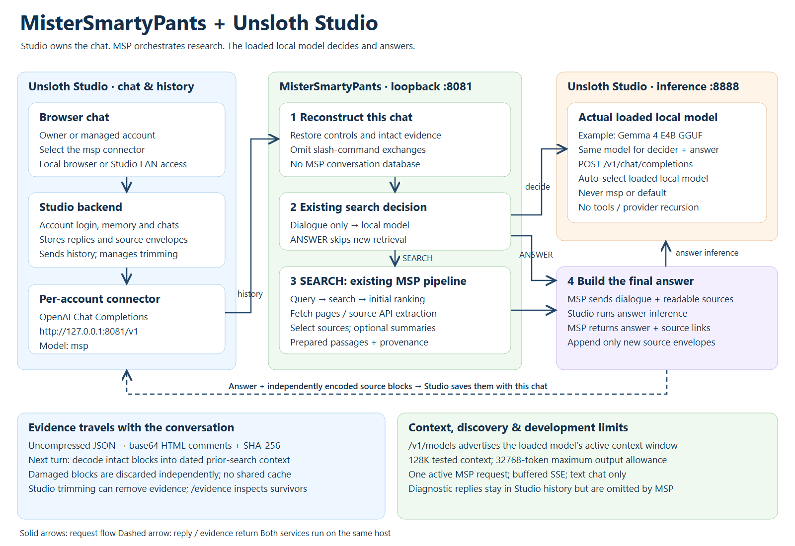

# Unsloth Studio integration architecture

[Scalable SVG](../MisterSmartyPants-Unsloth-Diagram.svg) ·
[Setup guide](unsloth-setup.md) ·
[Diagram source generator](../tools/draw_unsloth_architecture.py)

## Responsibilities and endpoints

| Component | Responsibility |
| --- | --- |
| Studio browser UI and backend | Account login, chat selection, memory, conversation storage, history trimming and provider requests. LAN browsers connect to Studio. |
| `studio_bridge.py`, loopback port 8081 | OpenAI Chat Completions facade advertising `msp`; reconstructs controls/evidence from the supplied transcript and invokes the existing MSP pipeline. |
| `websearchMCP.py` | Existing search decision, query planning, retrieval, extraction, ranking, optional summarization and answer construction. |
| Studio inference API, loopback port 8888 | Runs the actual loaded model for MSP's decider and final answer. The same loaded Gemma can serve both calls. |
| `studio_evidence.py` | Encodes and validates bounded source envelopes. It creates no database or shared chat cache. |

The two Studio roles share an application but use different routes. Chat selects
the **MSP provider**; MSP inference selects the **actual local model**. Routing an
inference request back to the MSP provider would start recursive orchestration.
The bridge validates local destination/model settings, disables redirects, sends
no Studio tool definitions, and rejects returning inference-marked requests.

## Request and answer flow

Model-selection change (2026-10-24): inference no longer reads `STUDIO_MODEL`.
Each request that needs inference obtains a fresh loaded-model list from Studio
and pins its single loaded local model for that request. Zero or multiple loaded
models, malformed discovery responses and provider/default identifiers fail before
inference with HTTP 503. Switching the loaded model affects the next request;
MSP does not silently switch midway through a research turn or auto-load models.
The context-window discovery cache described below is separate from this live
inference selection. See [migration steps](unsloth-setup.md#automatic-model-selection).

1. Studio sends text system/user/assistant messages to MSP's
   `POST /v1/chat/completions`. Memory may appear in the system messages.
2. The bridge creates a fresh `ChatSession`, replays supported control settings
   from user commands, omits slash-command exchanges, strips transport envelopes,
   and restores intact source passages beside their original assistant turn.
3. MSP's existing decider gets bounded conversational dialogue, excluding restored
   evidence. A request-scoped provider override sends inference to Studio's loaded
   model. Explicit search controls can bypass the ordinary decision step.
4. SEARCH follows the existing query/retrieval pipeline: configured search sources,
   initial ranking, fetch/API extraction, second-stage selection and optional
   summarization. ANSWER skips new retrieval. Ranking and summarization providers
   retain their existing configuration; not every processing stage runs on Gemma.
5. Final answer inference goes to the same discovered Studio model, with readable
   prior evidence and, when applicable, newly prepared sources. Source links are
   added according to MSP configuration.
6. The bridge appends independently encoded envelopes for only the new research
   turn's prepared passages and returns the answer to Studio. Studio stores the
   assistant text, including hidden HTML comments. On a later turn it sends that
   history back, allowing MSP to reconstruct the evidence without a separate store.

The original CLI and MSP browser server retain their configured inference paths.
The integration uses context-local inference/output hooks rather than replacing
process-wide provider settings or redirecting global standard output.

## Evidence and conversation ownership

Each source envelope holds its passage, title, URL, available publication/author
metadata, retrieval time, question/query, research-turn ID and source index/count.
It is uncompressed UTF-8 JSON encoded as base64 with a SHA-256 checksum. A damaged
source can be discarded independently while intact sources remain usable. Checksums
detect damage and are not signatures. Hidden comments are not encryption.

Studio's stored conversation is the carrier. MSP neither chooses a user store from
`/user` nor maintains a separate chat-ID mapping. A new request reconstructs only
the history Studio supplies, including the shared prefix of a branched chat if
Studio includes it. This relies on Studio to enforce account/conversation access.
MSP does not authenticate Studio's end user independently. The bridge's optional
bearer key authenticates a caller, not a per-user session.

`/evidence` reports restored sources, damage counts and context measurements;
`/evidence show` also displays full passages. Both operate without inference or
search, although context-window discovery may query Studio's model metadata.
Their visible replies stay in Studio history, but MSP excludes slash exchanges
from subsequent model dialogue. This difference matters for trimming: Studio
counts its own history, including encoded evidence and diagnostics; MSP's
reconstructed context replaces the carriers with readable passages.

## Context discovery and development bounds

MSP's `GET /v1/models` advertises `msp` and queries Studio's
`GET /api/inference/loaded-models` for the single loaded local model's active window.
It returns `max_model_len` and `context_length` when known, caching successful
lookups for 30 seconds and failures for 5 seconds. It does not substitute native
training capacity for the active context setting. The maximum requested output
allowance is 32768 tokens, separate from the total context window.

Evidence bounds are five selected sources per search, 64 KiB decoded per source,
256 KiB per outgoing research turn and 1 MiB of restored payloads per request.
Message/request character limits also apply. These bounds do not guarantee the
model prompt fits: Studio can trim messages before MSP sees them, and model token
counts include template/prompt overhead. Fully removed evidence turns cannot be
detected from the remaining transcript. `/evidence` labels its MSP token count as
a rough estimate, not Studio's trimming load or exact remaining capacity.

The launcher runs one loopback worker; overlapping pipeline requests receive 429.
SSE responses are buffered until the answer is complete. This remains a development
integration for broader testing, with no attachments, tool calls, Responses API,
exact usage accounting or true token streaming.
